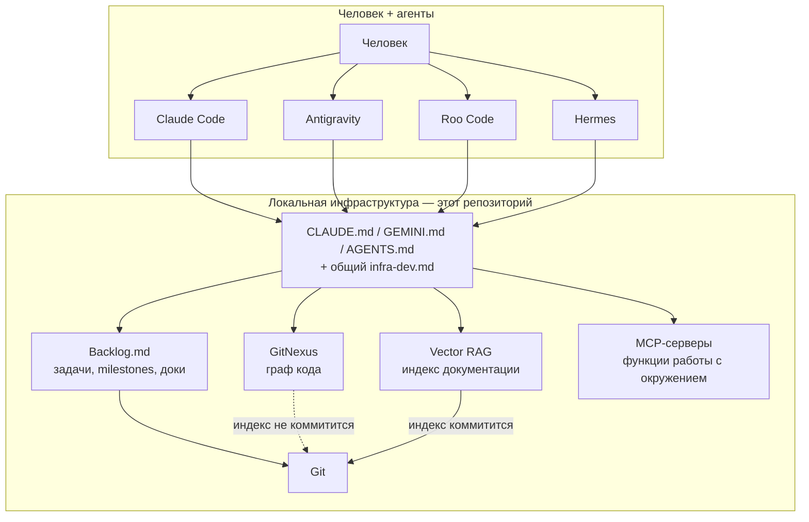
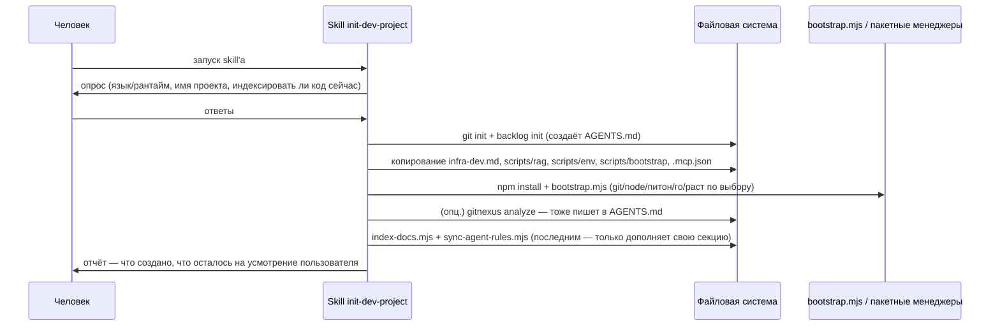
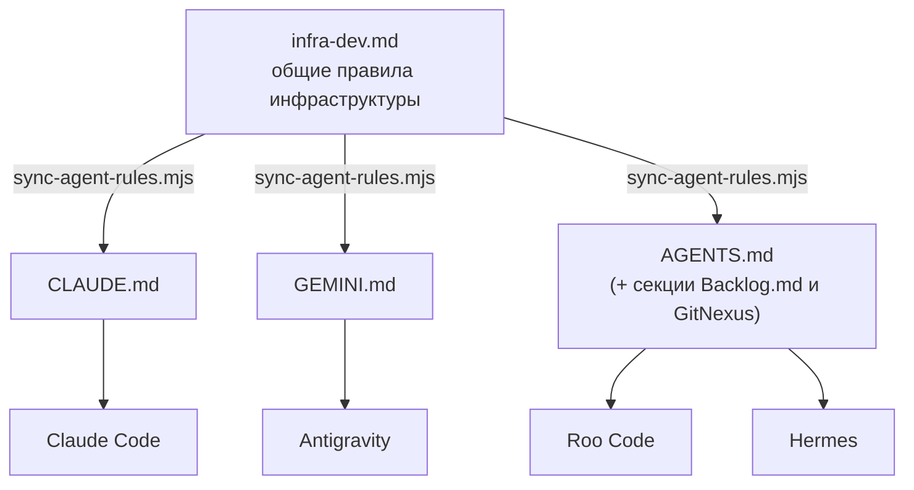
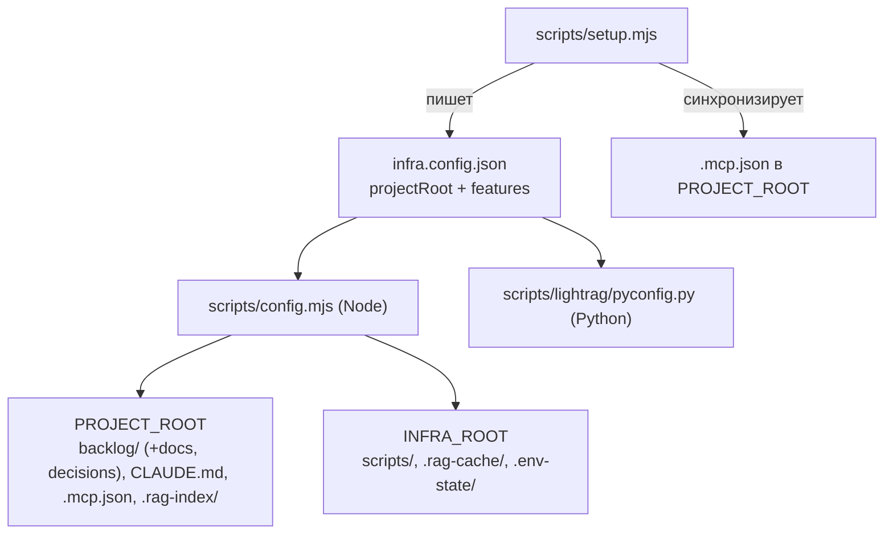
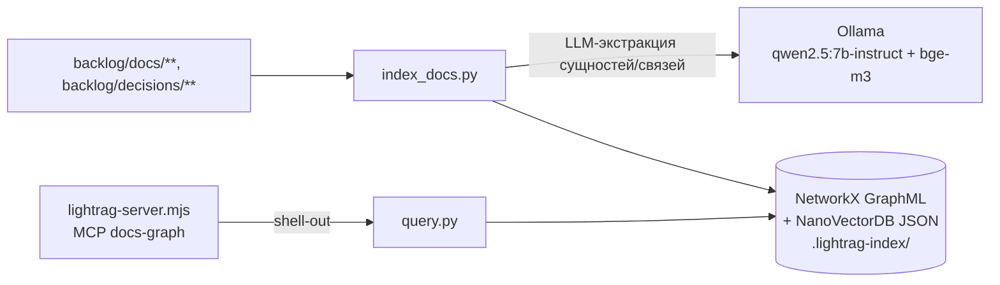
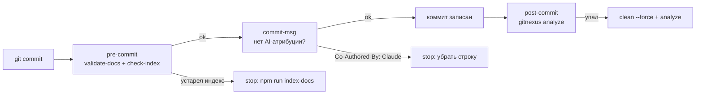

# ProjectTemplate

**Базовая инфраструктура для разработки софта человеком и ИИ-агентами в паре.**

Не фреймворк и не шаблон кода — это набор *локальных инструментов, конфигов и правил*,
которые ставятся в корень любого проекта и сразу дают человеку и агенту общий язык:
где лежат задачи, как агент понимает кодовую базу, как он ищет знания в документации,
и как ему запускать/трогать окружение без импровизации каждый раз с нуля.

Смысл — не изобретать процесс заново в каждом новом репозитории, а один раз довести
до состояния "работает предсказуемо" и переносить как есть.

> **Как развернуть это на своём проекте — гайд `doc-1` «Развёртывание инфраструктуры на новом проекте»** (`npx backlog.md doc view doc-1`, файл в [`backlog/docs/`](backlog/docs/)).
> Ниже — про то, что это и зачем; сама пошаговая инструкция там.

---

## Зачем это отдельный репозиторий

Каждый новый проект начинается с одних и тех же вопросов: где трекать задачи, как
агент не будет каждый раз читать всю кодовую базу заново, где хранить доки так, чтобы
их находил и человек, и агент, что именно агенту можно/нельзя делать с окружением.
`ProjectTemplate` — это то, что накопилось как ответ на эти вопросы, вынесенное так,
чтобы **клонироваться/накатываться в новый проект за один шаг**, а не собираться руками
каждый раз.

Рабочие принципы:

- **Файлы, а не сервисы.** Всё, что можно закоммитить в git (индексы, конфиги, правила),
  коммитится — никакой обязательной внешней БД или облака для базового цикла работы.
- **Двойное назначение документации.** Один и тот же документ должен быть одинаково
  полезен и человеку, который открыл его в редакторе, и агенту, который читает его
  как контекст перед задачей.
- **Разделение "код" и "знания о коде".** Граф кода (для рефакторинга/impact-анализа)
  и база знаний/документации (для ответа "как это работает и почему") — разные системы
  с разными свойствами, их не нужно смешивать в одном индексе.
- **Агент-агностичность.** Claude Code, Antigravity, Roo Code, Hermes — правила и MCP
  должны работать одинаково независимо от того, какой агент сейчас за рулём.

## Как это устроено сейчас



## Текущий стек

| Инструмент | Роль | Статус |
|---|---|---|
| **Git** | система контроля версий, источник истины по истории | ✅ используется |
| **[Backlog.md](https://github.com/MrLesk/Backlog.md)** | трекинг задач, milestones, decisions, доки — как для человека, так и для агента | ✅ используется |
| **GitNexus** | MCP-сервер, строит граф кода (вызовы, зависимости, impact-анализ) для контекста агента | ✅ используется |
| **Claude Code / Antigravity / Roo Code / Hermes** | агенты, работающие в паре с человеком | ✅ используется |

Проблема с GitNexus: он индексирует **весь** репозиторий как код, включая документацию —
а документации нужен другой тип индекса (смысловой поиск, а не граф вызовов). Отсюда —
первый открытый вопрос ниже.

## Что решаем и добавляем дальше

Ниже — не готовые решения, а направления, по которым уже есть черновая ясность и
(местами) рабочий прототип в `F:\PlatPhas`, взятый как референс.

### 1. Векторный RAG для документации — отдельно от GitNexus ✅ базовая версия готова

GitNexus продолжает индексировать **только код** (граф вызовов/зависимостей —
это его сильная сторона). Документация — целиком внутри `backlog/` (`backlog/docs/`,
`backlog/decisions/`), без отдельной верхнеуровневой `docs/` — получила отдельный
**смысловой** индекс, который:

- коммитится в git как обычные файлы (без внешней БД/сервиса);
- пересобирается детерминированно одной командой;
- отдаётся агенту через MCP-инструмент поиска.

Реализовано по прототипу из `F:\PlatPhas` (`@lancedb/lancedb` + локальные эмбеддинги),
но на актуальном `@huggingface/transformers` вместо устаревшего `@xenova/transformers`
(тот больше не поддерживается и тащит критическую CVE в `protobufjs` через старый
`onnxruntime-web`):

- `scripts/rag/index-docs.mjs` — обходит `backlog/docs/**/*.md`, `backlog/decisions/**/*.md`,
  режет на чанки по заголовкам/параграфам, строит
  эмбеддинги многоязычной моделью `Xenova/multilingual-e5-small` (только вычисление, без внешнего API)
  и складывает их в LanceDB-таблицу `.rag-index/docs.lance` — обычные файлы, коммитятся.
- `scripts/rag/rag-server.mjs` — MCP-сервер (`docs-rag` в `.mcp.json`) с тремя
  инструментами: `search_docs`, `list_docs`, `get_doc`.
- `scripts/rag/search-cli.mjs` — тот же поиск из терминала для человека, без агента:
  `npm run rag-search -- "запрос"`.
- Подробности и правила использования — гайд `doc-2` «Векторный RAG для документации» (`npx backlog.md doc view doc-2`).

Веса модели (~120MB, q8) кэшируются в `.rag-cache/` (в `.gitignore`) и скачиваются
автоматически при первом `npm run index-docs`. Актуальность индекса относительно
`backlog/` проверяет `npm run check-index` (хэш документов + версия чанкера в `meta.json`) —
это часть `npm run lint:docs` и `pre-commit` хука.

Для более крупной/связной технической документации (там, где важны связи между
разделами, а не только similarity) добавлен **LightRAG** — см. пункт 6 ниже.

```mermaid
graph LR
    subgraph Код
        SRC["src/**"]
    end
    subgraph Документация
        DOCS["backlog/docs/**, backlog/decisions/**"]
    end

    SRC --> GN["GitNexus<br/>граф вызовов/зависимостей"]
    DOCS --> RAG["Vector RAG<br/>LanceDB + локальные эмбеддинги"]
    DOCS -.опционально: features.lightrag.-> LR["LightRAG<br/>граф сущностей/связей"]

    GN -.не предназначен для коммита как есть.-> S1[("индекс графа кода")]
    RAG --коммитится в git--> S2[(".rag-index/*.lance")]
    LR --коммитится в git--> S3[(".lightrag-index/")]
```

**Решено:** `pre-commit` хук (`scripts/git-hooks/pre-commit`) не даёт закоммитить документацию
с устаревшим `.rag-index/` — `check-index` падает, пока не выполнен `npm run index-docs`.
Сам индекс по-прежнему пересобирается явно (`npm run index-docs`/`reindex_docs`): эмбеддинги
в хуке заняли бы десятки секунд на каждый коммит.

### 2. MCP-сервер `env-tools` — работа с окружением ✅ базовая версия готова

`scripts/env/env-server.mjs` (MCP `env-tools` в `.mcp.json`) даёт агенту функции работы с
локальным окружением проекта — не просто доступ к данным, а действия:

- `start_process(name, command, cwd?)` / `stop_process(name)` — фоновые процессы (dev-сервер,
  вотчер) с трекингом pid и логов в `.env-state/` (не коммитится). Процесс переживает
  перезапуск самого MCP-сервера — на Windows через PowerShell-обёртку, запущенную напрямую
  с `detached:true` (обычная связка `shell:true + detached:true` на Windows теряет
  перенаправление stdout/stderr в файл — проверено эмпирически, поэтому там отдельный путь;
  вариант через `cmd /c start /b` оказался нестабильным при закрытии терминала, TASK-1),
  на POSIX — стандартной идиомой `detached + unref`.
- `list_processes()` / `tail_log(name, lines?)` — что запущено и что пишет в лог.
- `reindex_docs()` — пересобрать векторный индекс документации из пункта 1, не выходя в шелл.

### 3. Кросс-платформенный bootstrap окружения ✅ базовая версия готова

`scripts/bootstrap/bootstrap.mjs` + декларативный `scripts/bootstrap/stack.json`: для каждого
инструмента в манифесте (`{name, check, winget, brew, apt, dnf, pacman}`) скрипт проверяет,
установлен ли он, определяет менеджер пакетов текущей ОС (`winget` / `brew` / `apt`/`dnf`/`pacman`)
и ставит недостающее — либо печатает инструкцию для ручной установки, если автоустановщика нет.
Базовый манифест покрывает `git` и `node` (нужны самой инфраструктуре); стек конкретного
проекта (Python/Go/Rust/…) дополняется на шаге `init-dev-project` (пункт 4).

### 4. Skill `init-dev-project` ✅ реализован

Собирает три предыдущих пункта плюс Backlog.md/GitNexus в одну последовательность:
опрос стека → `git init` + `backlog init` → копирование инфраструктуры из шаблона →
`npm install` (заодно ставит git-хуки) → `bootstrap.mjs` → (опционально) `gitnexus analyze` →
`index-docs.mjs` → `sync-agent-rules.mjs` → `lint:docs`/`test`. Полное описание шагов — `.claude/skills/init-dev-project/SKILL.md`
(лежит и здесь, в шаблоне, и в `~/.claude/skills/init-dev-project/`, чтобы быть доступным
в любом новом проекте).



### 5. Общий файл правил `infra-dev.md` ✅ реализован

Один файл `infra-dev.md` с описанием Backlog.md/GitNexus/RAG/env-tools конвенций,
который **не** инклюдится (агенты этого не поддерживают), а рассылается секцией через
`scripts/sync-agent-rules.mjs` — по маркерам `<!-- infra-dev:start/end -->`, идемпотентно,
не трогая остальное содержимое файла.

Важная деталь, всплывшая по ходу: общий файл называется **`AGENTS.md`** (во множественном
числе), не `AGENT.md` — так его называют и Backlog.md (`--agent-instructions agents`),
и GitNexus (`gitnexus analyze` тоже пишет в `AGENTS.md`). Изначальное название `AGENT.md`
было заменено, чтобы наша секция и секции этих инструментов жили в одном файле, а не
в трёх параллельных.



### 6. Конфигурация: standalone vs. подпапка, опциональные фичи ✅ реализовано

Инфраструктура должна одинаково работать и как **корень проекта** (обычный случай), и как
**подпапка внутри уже существующего проекта** (например `some-project/dev-infra/`) — во
втором случае `backlog/`/CLAUDE.md и т.п. лежат уровнем выше самих скриптов. Единый
`infra.config.json` (`{ projectRoot, features }`) и `scripts/config.mjs` (Node) /
`scripts/lightrag/pyconfig.py` (Python) — общий источник путей: `PROJECT_ROOT` (`backlog/`
со всей документацией внутри, CLAUDE.md, `.rag-index/`, `.mcp.json`) и `INFRA_ROOT`
(сами скрипты, кэши, runtime-состояние). Не настраивается руками — `node scripts/setup.mjs` (интерактивно или
флагами) пишет конфиг и пересобирает `.mcp.json` с правильными относительными путями.

Часть функций — опциональна и включается флагом в `features` (по умолчанию: всё включено,
кроме `lightrag` — см. пункт 6). Не форсируется на пользователя: `init-dev-project`
явно спрашивает про LightRAG отдельным вопросом с предупреждением о цене (Python, Ollama,
несколько ГБ, медленная индексация), а не включает по умолчанию вместе с остальным.



### 7. LightRAG — граф технической документации ✅ базовая версия готова (опционально)

По запросу — граф сущностей и связей поверх той же документации, что индексирует
Vector RAG, но через LLM-экстракцию, а не просто эмбеддинг. Полностью локально, без
тяжёлой БД: **NetworkX** (граф в GraphML-файле) + **NanoVectorDB** (JSON) — те же
файловые бэкенды, что штатно использует `lightrag-hku`. LLM и эмбеддинги — через
локальную **Ollama** (`qwen2.5:7b-instruct` для экстракции, `bge-m3` для эмбеддингов),
без внешнего API.

- `scripts/lightrag/index_docs.py` / `query.py` — индексация и запрос (режимы `local`/
  `global`/`hybrid`/`naive`/`mix`).
- `scripts/lightrag/lightrag-server.mjs` — Node MCP-обёртка (`docs-graph` в `.mcp.json`,
  инструменты `search_docs_graph`/`reindex_docs_graph`), сама на Python не завязана —
  просто шлёт запросы в venv-интерпретатор.
- `scripts/lightrag/setup.mjs` — отдельный, явно тяжёлый шаг (`npm run lightrag-setup`):
  создаёт изолированный venv, ставит `lightrag-hku`, проверяет Ollama и докачивает модели.
  **Не запускается автоматически** вместе с остальным bootstrap'ом.
- Изолированный Python venv (`scripts/lightrag/.venv/`) создаётся explicit-путём к системному
  Python, найденному перебором (`py -3` / `python` / `python3`, с проверкой, что `pip`
  реально работает) — **не** полагаемся на первый `python` в PATH: на машине, где это
  собиралось, `python` указывал на venv стороннего установленного агента со сломанным pip.



**Найденные по пути грабли** (см. `.claude/memory/` в шаблоне для полной версии):
- `OLLAMA_HOST` как имя переменной окружения — плохой выбор для клиента: на машине уже
  может быть системная `OLLAMA_HOST` для конфигурации **сервера** Ollama (например "0.0.0.0"),
  и как адрес для подключения клиента она не годится. Используется отдельное имя
  (`LIGHTRAG_OLLAMA_HOST`).
- `num_ctx` в опциях модели Ollama не ставить бездумно большим (например 32768) — на
  видеопамяти со скромным запасом пересборка KV-cache под такой контекст может занимать
  многие минуты вместо секунд. Использован разумный `8192`.

### 8. Git-хуки и валидация документации ✅ реализовано

Правила, которые можно проверить машиной, получают скрипт, а не только абзац в
`infra-dev.md` (правило 19). Собрано из живых проектов (WorldSim — post-commit с
самовосстановлением индекса GitNexus, ProjectHub — `validate-docs`/`check-index`,
ProxiHorror/ProjectHub — запрет AI-атрибуции в коммитах):

- `scripts/git-hooks/pre-commit` — `npm run lint:docs`: `scripts/validate-docs.mjs`
  (frontmatter с `id`/`title`, даты только строками в кавычках, картинки одной строкой,
  локальные файлы существуют, раздел `section` у документов, ссылки `[[id]]` и якоря
  `[[id#Заголовок]]` ведут на существующее — `scripts/doc-rules.mjs`) + `scripts/rag/check-index.mjs` (хэш документов и версия
  чанкера в `.rag-index/meta.json` совпадают с `backlog/`).
- `scripts/git-hooks/commit-msg` — отклоняет `Co-Authored-By: Claude …`, `Generated with
  Claude Code`, `Generated by AI`, `🤖` и аналоги; соавторы-люди проходят.
- `scripts/git-hooks/post-commit` — `gitnexus analyze`; если инкрементальный проход уронил
  FTS-индекс — `clean --force` + `analyze`; молчит в проектах без `.gitnexus/`.
- `scripts/git-hooks/install.mjs` — подключает каталог через `core.hooksPath` (хуки
  версионируются вместе с проектом), вызывается из `npm install` (`prepare`) и `setup.mjs`.
  Обход — только по явной просьбе: `--no-verify` или `INFRA_HOOKS_SKIP=1`.
- `scripts/git-hooks/hooks.test.mjs` — `npm test`: порядок вызовов post-commit на заглушке
  gitnexus, отказы/пропуски commit-msg, интеграционный прогон pre-commit на документации шаблона.
- `.gitattributes` — LF для sh/хуков/юнитов systemd/скриптов, CRLF для `.bat`/`.ps1`:
  CRLF в хуке или деплой-скрипте на Linux — это `$'\r': command not found`.



### Веб-интерфейсы: `scripts/web.mjs`, `start-web.bat`/`.sh` ✅ реализовано

Backlog.md и GitNexus умеют поднимать свои веб-UI (`backlog browser`, `gitnexus serve`).
`scripts/web.mjs start|stop|status` поднимает их через уже готовый `env-tools` (трекинг
pid/логов, без дублей на одном порту), пропуская то, что ещё не проинициализировано
(`backlog/` нет → пропустить с подсказкой, `.gitnexus/` нет → пропустить с подсказкой).
`start-web.bat` (Windows, CRLF) и `start-web.sh` — тонкие обёртки для запуска двойным
кликом/из терминала без необходимости помнить node-команду.

## Статус

| Компонент | Статус |
|---|---|
| Git / Backlog.md / GitNexus в связке | ✅ есть и используется |
| Нативный MCP-сервер Backlog.md (`backlog mcp start`) | ✅ подключён (`.mcp.json`, фича `backlogMcp`) |
| Vector RAG для документации (отдельно от GitNexus) | ✅ базовая версия готова (`scripts/rag/`) |
| MCP-сервер `env-tools` (процессы, логи, reindex) | ✅ базовая версия готова (`scripts/env/`) |
| Кросс-платформенный bootstrap (`stack.json`) | ✅ базовая версия готова (`scripts/bootstrap/`) |
| Skill `init-dev-project` | ✅ реализован (`.claude/skills/init-dev-project/`) |
| Общий `infra-dev.md` для CLAUDE.md/GEMINI.md/AGENTS.md | ✅ реализован |
| Конфигурация (standalone/подпапка, опциональные фичи) | ✅ реализовано (`infra.config.json`, `scripts/setup.mjs`) |
| LightRAG — граф технической документации | ✅ базовая версия готова, опционально (`scripts/lightrag/`) |
| Веб-интерфейсы Backlog.md/GitNexus (`scripts/web.mjs`) | ✅ реализовано |
| Git-хуки (`scripts/git-hooks/`: lint:docs, запрет AI-атрибуции, переиндексация GitNexus) | ✅ реализовано, ставятся через `core.hooksPath` при `npm install` |
| Валидатор документации `npm run lint:docs` (frontmatter, даты, картинки, разделы и ссылки `[[id]]`, актуальность индекса) | ✅ реализовано (`scripts/validate-docs.mjs`, `scripts/doc-rules.mjs`, `scripts/rag/check-index.mjs`) |
| Актуальность RAG-индекса | ✅ гейт в `pre-commit`; пересборка по-прежнему явная (`npm run index-docs`) |

Легенда: ✅ — работает и используется сегодня, 🧩 — открытый вопрос / не начато.
