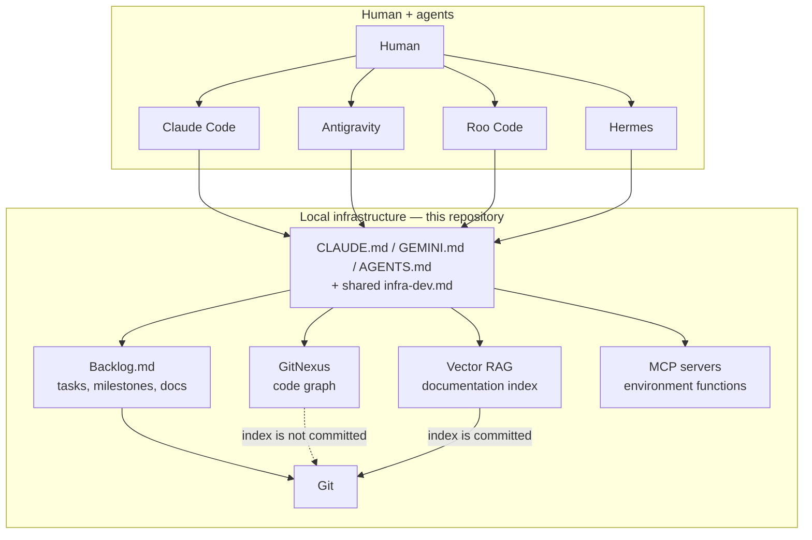
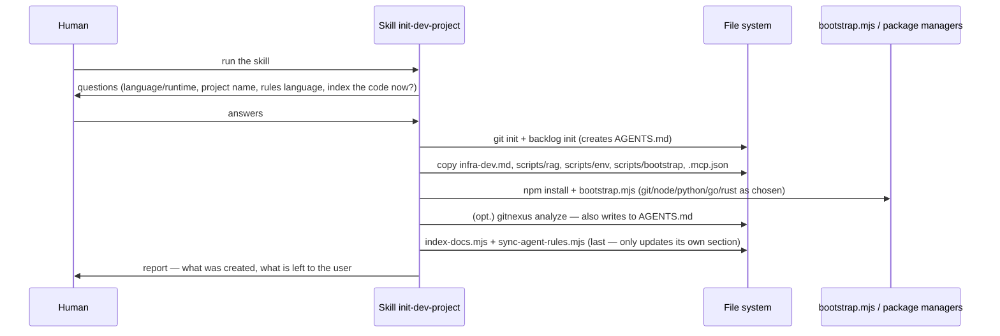
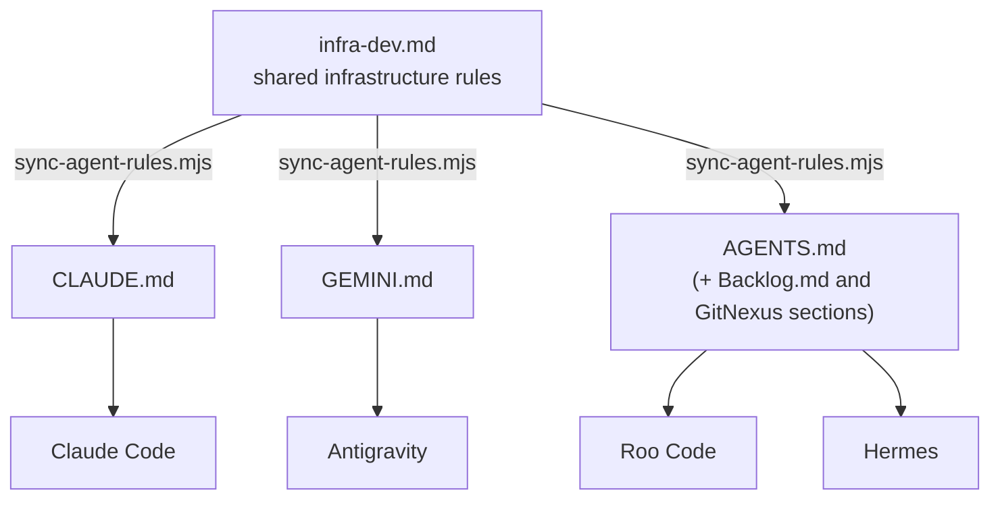
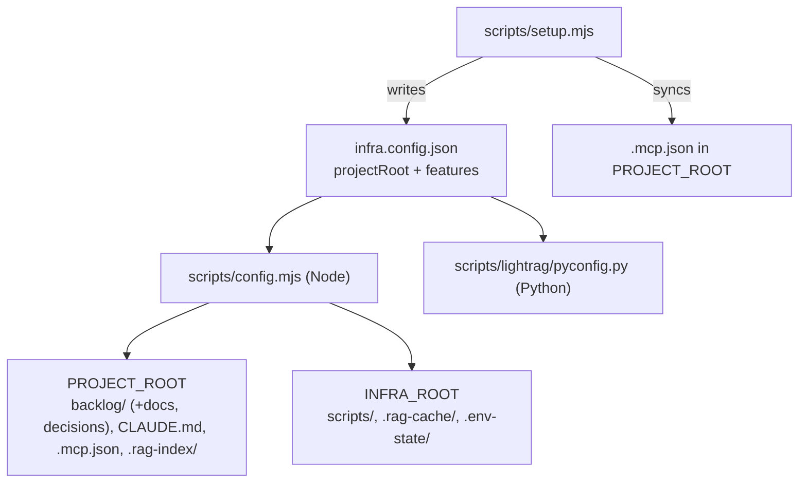
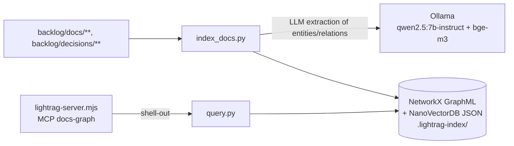
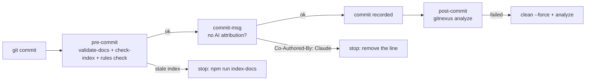

# ProjectTemplate

[Русская версия](README.ru.md)

> **This is the built-in base template of ProjectHub** (decision-78 in ProjectHub). It ships with the application build
> (`resources/template`) and is applied by the "Initialize" window or the new project wizard: ProjectHub itself sets up the foundation (git,
> Backlog.md, documentation, rules), and this template adds the infrastructure — to the root of a new
> folder or to `.projecthub/infra/` of an existing project. What is copied where and which features and commands exist is set by
> `projecthub-template.json`; the `infra-dev.md` rules are marked up with `<!-- if:feature -->` conditions. The manifest format is
> described in the ProjectHub document "Project templates: manifest, conditional rules and trust" (doc-13).
>
> Files in the template root are in English; translations live in `locales/<code>/` under the same paths (now `locales/ru/`:
> rules, the critic subagent, the `init-dev-project` skill) and are picked by the project language (decision-231 in ProjectHub).
>
> The source of changes is the separate ProjectTemplate repository, an aggregator of practices from live projects (decision-1
> in ProjectTemplate). This is its built-in copy, so that ProjectHub does not depend on an external template when initializing;
> changes are carried over here by hand. Only `projecthub-template.json` and the introduction of the README files
> are specific to the copy.
> The copy has no `rag-control-queries.json`, `.gitnexusignore` or `scripts/idea-bin.test.mjs`: ProjectTemplate has its own queries and
> indexing block, and the template does not put the idea bin `backlog/idea-bin/` into a project (`backlog/**` is not part of a template).

**A base infrastructure for software development by a human and AI agents working as a pair.**

Not a framework and not a code template — it is a set of *local tools, configs and rules*
that go into the root of any project and immediately give the human and the agent a common language:
where the tasks are, how the agent understands the code base, how it searches the documentation for knowledge,
and how it starts and touches the environment without improvising from scratch every time.

The point is not to reinvent the process in every new repository, but to bring it once
to a "works predictably" state and carry it over as is.

> **How to deploy this in your project** — the "Initialize" window in ProjectHub (the button on a project or "Create from
> template"). By hand, without ProjectHub: copy the folder, then `node scripts/setup.mjs` and `npm run sync-rules`
> (for Russian rules, add `"locale": "ru"` to `infra.config.json`).
> Below is what this is and why.

---

## Why this is a separate repository

Every new project starts with the same questions: where to track tasks, how to keep the
agent from reading the whole code base again every time, where to store docs so that
both the human and the agent can find them, what exactly the agent may and may not do with the environment.
`ProjectTemplate` is what accumulated as the answer to these questions, packaged so that
it **is cloned or rolled into a new project in one step** instead of being assembled by hand
every time.

Working principles:

- **Files, not services.** Everything that can be committed to git (indexes, configs, rules)
  is committed — no mandatory external database or cloud for the basic work cycle.
- **Documentation with a dual purpose.** The same document must be equally
  useful to a human who opened it in an editor and to an agent that reads it
  as context before a task.
- **"Code" and "knowledge about code" are separate.** The code graph (for refactoring and impact analysis)
  and the knowledge/documentation base (for answering "how does it work and why") are different systems
  with different properties; there is no need to mix them in one index.
- **Agent-agnostic.** Claude Code, Antigravity, Roo Code, Hermes — rules and MCP
  must work the same way regardless of which agent is at the wheel.

## How it works now



## Current stack

| Tool | Role | Status |
|---|---|---|
| **Git** | version control, the source of truth for history | ✅ in use |
| **[Backlog.md](https://github.com/MrLesk/Backlog.md)** | tracking tasks, milestones, decisions, docs — for both the human and the agent | ✅ in use |
| **GitNexus** | an MCP server that builds a code graph (calls, dependencies, impact analysis) for the agent's context | ✅ in use |
| **Claude Code / Antigravity / Roo Code / Hermes** | agents working as a pair with the human | ✅ in use |

The problem with GitNexus: it indexes the **whole** repository as code, including the documentation —
and documentation needs a different kind of index (semantic search, not a call graph). Hence
the first open question below.

## What we solve and add next

Below are not finished solutions but directions where there is already rough clarity and
(in places) a working prototype in `F:\PlatPhas`, taken as a reference.

### 1. Vector RAG for documentation — separate from GitNexus ✅ base version ready

GitNexus keeps indexing **only code** (the call/dependency graph is
its strength). The documentation — entirely inside `backlog/` (`backlog/docs/`,
`backlog/decisions/`), with no separate top-level `docs/` — got a separate
**semantic** index that:

- is committed to git as regular files (no external database or service);
- is rebuilt deterministically with one command;
- is served to the agent through an MCP search tool.

Implemented after the prototype in `F:\PlatPhas` (`@lancedb/lancedb` + local embeddings),
but on the current `@huggingface/transformers` instead of the outdated `@xenova/transformers`
(which is no longer maintained and pulls a critical CVE in `protobufjs` through the old
`onnxruntime-web`):

- `scripts/rag/index-docs.mjs` — walks `backlog/docs/**/*.md`, `backlog/decisions/**/*.md`,
  splits them into chunks by headings and paragraphs, computes
  embeddings with the multilingual model `Xenova/multilingual-e5-small` (computation only, no external API)
  and stores them in the LanceDB table `.rag-index/docs.lance` — regular files, committed.
- `scripts/rag/rag-server.mjs` — an MCP server (`docs-rag` in `.mcp.json`) with three
  tools: `search_docs`, `list_docs`, `get_doc`.
- `scripts/rag/search-cli.mjs` — the same search from the terminal for a human, without an agent:
  `npm run rag-search -- "query"`.
- Details and usage rules — the guide `doc-2` "Vector RAG for documentation" in ProjectTemplate (`npx backlog.md doc view doc-2`).

The model weights (~120MB, q8) are cached in `.rag-cache/` (in `.gitignore`) and downloaded
automatically on the first `npm run index-docs`. Index freshness against
`backlog/` is checked by `npm run check-index` (a document hash + the chunker version in `meta.json`) —
it is part of `npm run lint:docs` and the `pre-commit` hook.

For larger, more connected technical documentation (where links between
sections matter, not just similarity) there is **LightRAG** — see item 7 below.

```mermaid
graph LR
    subgraph Code
        SRC["src/**"]
    end
    subgraph Documentation
        DOCS["backlog/docs/**, backlog/decisions/**"]
    end

    SRC --> GN["GitNexus<br/>call/dependency graph"]
    DOCS --> RAG["Vector RAG<br/>LanceDB + local embeddings"]
    DOCS -.optional: features.lightrag.-> LR["LightRAG<br/>entity/relation graph"]

    GN -.not meant to be committed as is.-> S1[("code graph index")]
    RAG --committed to git--> S2[(".rag-index/*.lance")]
    LR --committed to git--> S3[(".lightrag-index/")]
```

**Solved:** the `pre-commit` hook (`scripts/git-hooks/pre-commit`) does not let you commit documentation
with a stale `.rag-index/` — `check-index` fails until `npm run index-docs` is run.
The index itself is still rebuilt explicitly (`npm run index-docs`/`reindex_docs`): embeddings
in the hook would take tens of seconds on every commit.

### 2. The `env-tools` MCP server — working with the environment ✅ base version ready

`scripts/env/env-server.mjs` (MCP `env-tools` in `.mcp.json`) gives the agent functions for the
project's local environment — not just data access, but actions:

- `start_process(name, command, cwd?)` / `stop_process(name)` — background processes (a dev server,
  a watcher) with pid and log tracking in `.env-state/` (not committed). A process survives
  a restart of the MCP server itself — on Windows through a PowerShell wrapper started directly
  with `detached:true` (the usual `shell:true + detached:true` combination on Windows loses
  the redirection of stdout/stderr to a file — verified empirically, hence a separate path there;
  the `cmd /c start /b` variant turned out unstable when the terminal closes, TASK-1),
  on POSIX — the standard `detached + unref` idiom.
- `list_processes()` / `tail_log(name, lines?)` — what is running and what it writes to the log.
- `reindex_docs()` — rebuild the documentation vector index from item 1 without going to the shell.

### 3. A cross-platform environment bootstrap ✅ base version ready

`scripts/bootstrap/bootstrap.mjs` + the declarative `scripts/bootstrap/stack.json`: for each
tool in the manifest (`{name, check, winget, brew, apt, dnf, pacman}`) the script checks
whether it is installed, detects the package manager of the current OS (`winget` / `brew` / `apt`/`dnf`/`pacman`)
and installs what is missing — or prints manual installation instructions if there is no automatic installer.
The base manifest covers `git` and `node` (the infrastructure itself needs them); the stack of a particular
project (Python/Go/Rust/…) is added at the `init-dev-project` step (item 4).

### 4. The `init-dev-project` skill ✅ implemented

Puts the three previous items plus Backlog.md/GitNexus into one sequence:
stack questions → `git init` + `backlog init` → copying the infrastructure from the template →
`npm install` (which also installs the git hooks) → `bootstrap.mjs` → (optionally) `gitnexus analyze` →
`index-docs.mjs` → `sync-agent-rules.mjs` → `lint:docs`/`test`. The full description of the steps is in `.claude/skills/init-dev-project/SKILL.md`
(it lives both here, in the template, and in `~/.claude/skills/init-dev-project/`, so that it is available
in any new project).



### 5. The shared rules file `infra-dev.md` ✅ implemented

One `infra-dev.md` file describing the Backlog.md/GitNexus/RAG/env-tools conventions,
which is **not** included (agents do not support that) but sent out as a section by
`scripts/sync-agent-rules.mjs` — between the `<!-- infra-dev:start/end -->` markers, idempotently,
without touching the rest of the file.

An important detail that came up along the way: the shared file is called **`AGENTS.md`** (plural),
not `AGENT.md` — that is what both Backlog.md (`--agent-instructions agents`)
and GitNexus (`gitnexus analyze` also writes to `AGENTS.md`) call it. The original name `AGENT.md`
was replaced so that our section and the sections of these tools live in one file, not
in three parallel ones.



### 6. Configuration: standalone vs. subfolder, optional features ✅ implemented

The infrastructure must work the same way both as the **project root** (the usual case) and as
a **subfolder inside an existing project** (for example `some-project/dev-infra/`) — in the
second case `backlog/`, CLAUDE.md and so on are one level above the scripts themselves. A single
`infra.config.json` (`{ projectRoot, features }`) and `scripts/config.mjs` (Node) /
`scripts/lightrag/pyconfig.py` (Python) are the common source of paths: `PROJECT_ROOT` (`backlog/`
with all the documentation inside, CLAUDE.md, `.rag-index/`, `.mcp.json`) and `INFRA_ROOT`
(the scripts themselves, caches, runtime state). It is not configured by hand — `node scripts/setup.mjs` (interactively or
with flags) writes the config and rebuilds `.mcp.json` with correct relative paths.

Some functions are optional and are switched on by a flag in `features` (by default everything is on
except `lightrag` — see item 7). It is not forced on the user: `init-dev-project`
explicitly asks about LightRAG in a separate question with a warning about the cost (Python, Ollama,
several GB, slow indexing) instead of enabling it by default with the rest.



### 7. LightRAG — a graph of the technical documentation ✅ base version ready (optional)

On request — a graph of entities and relations over the same documentation that the
Vector RAG indexes, but through LLM extraction rather than plain embeddings. Fully local, without
a heavy database: **NetworkX** (the graph in a GraphML file) + **NanoVectorDB** (JSON) — the same
file backends that `lightrag-hku` uses by default. The LLM and embeddings go through a
local **Ollama** (`qwen2.5:7b-instruct` for extraction, `bge-m3` for embeddings),
with no external API.

- `scripts/lightrag/index_docs.py` / `query.py` — indexing and querying (modes `local`/
  `global`/`hybrid`/`naive`/`mix`).
- `scripts/lightrag/lightrag-server.mjs` — a Node MCP wrapper (`docs-graph` in `.mcp.json`,
  tools `search_docs_graph`/`reindex_docs_graph`), not tied to Python itself —
  it just sends requests to the venv interpreter.
- `scripts/lightrag/setup.mjs` — a separate, explicitly heavy step (`npm run lightrag-setup`):
  creates an isolated venv, installs `lightrag-hku`, checks Ollama and downloads the models.
  **It does not run automatically** with the rest of the bootstrap.
- The isolated Python venv (`scripts/lightrag/.venv/`) is created through an explicit path to the system
  Python, found by trying candidates (`py -3` / `python` / `python3`, checking that `pip`
  really works) — we **do not** rely on the first `python` in PATH: on the machine where this
  was built, `python` pointed to the venv of a third-party installed agent with a broken pip.



**Pitfalls found along the way** (see `.claude/memory/` in ProjectTemplate for the full version):
- `OLLAMA_HOST` as an environment variable name is a bad choice for a client: the machine may already
  have a system `OLLAMA_HOST` that configures the Ollama **server** (for example "0.0.0.0"),
  and it does not work as an address for a client to connect to. A separate name is used
  (`LIGHTRAG_OLLAMA_HOST`).
- Do not set `num_ctx` in the Ollama model options thoughtlessly high (for example 32768) — with
  modest spare video memory, rebuilding the KV cache for such a context can take
  many minutes instead of seconds. A reasonable `8192` is used.

### 8. Git hooks and documentation validation ✅ implemented

Rules that a machine can check get a script, not just a paragraph in
`infra-dev.md` (rule 19). Collected from live projects (WorldSim — post-commit with
self-healing of the GitNexus index, ProjectHub — `validate-docs`/`check-index`,
ProxiHorror/ProjectHub — no AI attribution in commits):

- `scripts/git-hooks/pre-commit` — `npm run lint:docs`: `scripts/validate-docs.mjs`
  (frontmatter with `id`/`title`, dates only as quoted strings, images on one line,
  local files exist, a `section` on documents, `[[id]]` links and `[[id#Heading]]`
  anchors lead to something that exists — `scripts/doc-rules.mjs`) + `scripts/rag/check-index.mjs` (the document hash and the chunker
  version in `.rag-index/meta.json` match `backlog/`); then the generated rule files are compared with the rules source
  using the git index (`sync-agent-rules.mjs --check --staged`).
- `scripts/git-hooks/commit-msg` — rejects `Co-Authored-By: Claude …`, `Generated with
  Claude Code`, `Generated by AI`, `🤖` and equivalents; human co-authors pass.
- `scripts/git-hooks/post-commit` — `gitnexus analyze`; if the incremental pass broke the
  FTS index — `clean --force` + `analyze`; silent in projects without `.gitnexus/`. It does not call
  `analyze` if since the last indexing (`lastCommit` in `.gitnexus/`) only files
  excluded by `.gitignore`/`.gitnexusignore` changed — for example tasks and documents in `backlog/`.
- `scripts/git-hooks/install.mjs` — connects the folder through `core.hooksPath` (the hooks
  are versioned with the project); called from `npm install` (`prepare`) and `setup.mjs`.
  Bypass only on explicit request: `--no-verify` or `INFRA_HOOKS_SKIP=1`.
- `scripts/git-hooks/hooks.test.mjs` — `npm test`: the post-commit call order on a gitnexus
  stub, commit-msg refusals and passes, an integration run of pre-commit on the project documentation.
- `.gitattributes` — LF for sh, hooks, systemd units and scripts, CRLF for `.bat`/`.ps1`:
  CRLF in a hook or a deploy script on Linux means `$'\r': command not found`.



### Web UIs: `scripts/web.mjs`, `start-web.bat`/`.sh` ✅ implemented

Backlog.md and GitNexus can start their web UIs (`backlog browser`, `gitnexus serve`).
`scripts/web.mjs start|stop|status` starts them through the ready-made `env-tools` (pid/log
tracking, no duplicates on one port), skipping what is not initialized yet
(no `backlog/` → skip with a hint, no `.gitnexus/` → skip with a hint).
`start-web.bat` (Windows, CRLF) and `start-web.sh` are thin wrappers for starting with a double
click or from the terminal without having to remember the node command.

## Status

| Component | Status |
|---|---|
| Git / Backlog.md / GitNexus together | ✅ present and in use |
| Native Backlog.md MCP server (`backlog mcp start`) | ✅ connected (`.mcp.json`, the `backlogMcp` feature) |
| Vector RAG for documentation (separate from GitNexus) | ✅ base version ready (`scripts/rag/`) |
| The `env-tools` MCP server (processes, logs, reindex) | ✅ base version ready (`scripts/env/`) |
| Cross-platform bootstrap (`stack.json`) | ✅ base version ready (`scripts/bootstrap/`) |
| The `init-dev-project` skill | ✅ implemented (`.claude/skills/init-dev-project/`) |
| Shared `infra-dev.md` for CLAUDE.md/GEMINI.md/AGENTS.md | ✅ implemented, English with a Russian translation (`locales/ru/`) |
| Configuration (standalone/subfolder, optional features) | ✅ implemented (`infra.config.json`, `scripts/setup.mjs`) |
| LightRAG — a graph of the technical documentation | ✅ base version ready, optional (`scripts/lightrag/`) |
| Backlog.md/GitNexus web UIs (`scripts/web.mjs`) | ✅ implemented |
| Git hooks (`scripts/git-hooks/`: lint:docs, rules check, no AI attribution, GitNexus reindexing) | ✅ implemented, installed through `core.hooksPath` on `npm install` |
| Documentation validator `npm run lint:docs` (frontmatter, dates, images, sections and `[[id]]` links, index freshness) | ✅ implemented (`scripts/validate-docs.mjs`, `scripts/doc-rules.mjs`, `scripts/rag/check-index.mjs`) |
| RAG index freshness | ✅ a gate in `pre-commit`; the rebuild is still explicit (`npm run index-docs`) |

Legend: ✅ — works and is in use today, 🧩 — an open question / not started.
